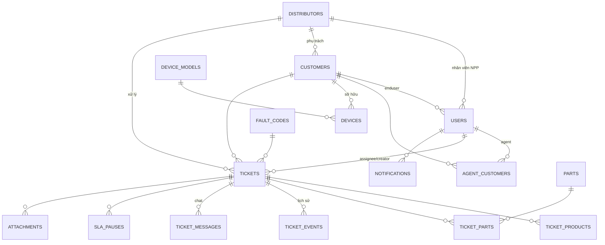

# 03. Thiết kế database (PostgreSQL)

Schema đầy đủ: `sql/V1__init_schema.sql`. Dưới đây là ERD và quy tắc.

## ERD

## Nhóm bảng
| Nhóm | Bảng |
|---|---|
| Người dùng & quyền | users, role_permissions, agent_customers |
| Danh mục | distributors, device_models, parts, fault_codes |
| Khách hàng & thiết bị | customers, devices |
| Ticket | tickets, ticket_products, ticket_parts, ticket_events, ticket_messages, sla_pauses, attachments, ticket_sequences |
| Khác | notifications |

## Quy tắc quan trọng
1. **`tickets.status`** là enum chuỗi (xem docs/05). Không sửa trực tiếp, chỉ qua workflow.
2. **Ảnh chụp thông tin khách (snapshot)**: ticket lưu `customer_company/contact/phone/email` tại thời điểm tạo, vì khách hàng có thể đổi thông tin sau này nhưng ticket cũ phải giữ nguyên.
3. **Hạn bảo hành** tính từ `devices`: `warranty_end = COALESCE(start_date, ship_date) + warranty_years năm`. Tính ở Java (`WarrantyService`), không lưu cột.
4. **SLA**: `proc_hours = (end - created_at - tổng sla_pauses) / 1h`, `end = closed_at` hoặc thời điểm hiện tại hoặc `updated_at` nếu rejected/cancelled. Quá hạn khi `proc_hours > 7*24`. Tính ở `SlaCalculator`, không lưu cột.
5. **ticket_events** chỉ INSERT, không UPDATE/DELETE (audit trail).
6. **notifications** nhắm tới một trong: `to_user_id`, `to_role`, `to_distributor_id`, `to_customer_id` (đúng 1 cột có giá trị).
7. Khoá ngoại có `ON DELETE RESTRICT` (mặc định); user/catalog bị vô hiệu bằng `active=false` thay vì xoá.
8. Index: `tickets(status)`, `tickets(distributor_id, status)`, `tickets(customer_id)`, `tickets(created_at)`, `devices(customer_id)`, `ticket_events(ticket_id, at)`.

## Quy đổi từ demo (localStorage) sang DB
| Demo (`DB.xxx`) | Bảng |
|---|---|
| users | users (+ agent_customers cho `customerIds`) |
| customers | customers |
| devices | devices |
| tickets (history[]) | tickets + ticket_events |
| tickets.products[] | ticket_products |
| tickets.parts[] / diagnosis.estParts[] | ticket_parts (`kind` = `used` / `estimate`) |
| tickets.conversation[] + internal[] | ticket_messages (`internal` true/false) |
| tickets.slaPauses[] | sla_pauses |
| tickets.attachments[] | attachments |
| tickets.test / delivery / approval / feedback | cột trong tickets |
| notifs | notifications |
| perms | role_permissions |
| catalog.{models,parts,faults,dists} | device_models, parts, fault_codes, distributors |
