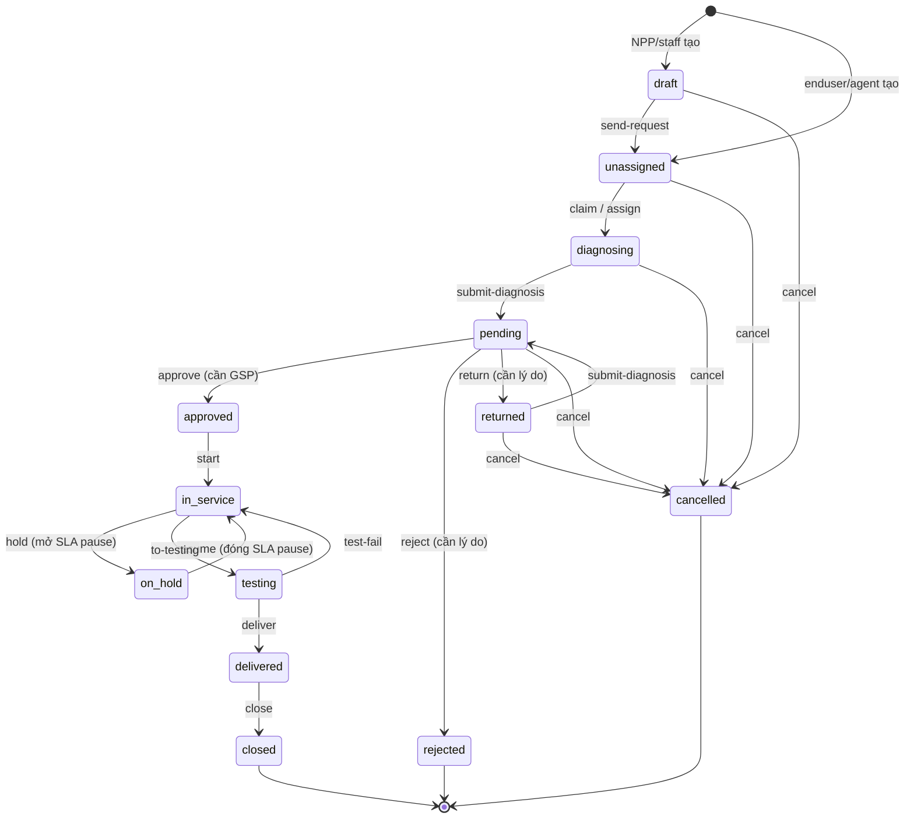

# 05. Workflow ticket, SLA, phân quyền

Nguồn: suy ra từ code demo (`detail.js` hàm `A.wf`, `data.js`, `core.js`). Chỗ **[XÁC NHẬN]** là suy luận.

## 1. Loại dịch vụ (`type`)
`RW` Bảo hành · `OW` Hết bảo hành · `PR` Sửa có phí · `OT` Khác (tư vấn). Với `OT` không có chẩn đoán/sửa chữa phức tạp.

## 2. Sơ đồ trạng thái

Trạng thái kết thúc: `closed`, `rejected`, `cancelled` (không còn là "mở").

## 3. Quy tắc từng bước
- **submit-diagnosis**: `diag_text` bắt buộc. Thông báo role `manager` + `engineer` (`n_submitted`).
- **approve**: `gspNo` bắt buộc, khớp `^[A-Z0-9-]{6,20}$` (uppercase), **không trùng** ticket khác; `maNo` tuỳ chọn, `^[A-Z0-9-]{2,20}$`. Thông báo NPP (`n_approved`).
- **reject / return / cancel**: bắt buộc `note`. `return` thông báo NPP (`n_returned`).
- **hold**: bắt buộc `reason` ∈ {wait_customer, customer_hold, wait_parts, wait_approval, wait_shipping, other}; `other` bắt buộc `note`. Mở dòng `sla_pauses`.
- **resume**: đóng `sla_pauses` đang mở (`to_at=now`, `resumed_by`).
- **deliver**: ghi `test_result=pass`, thông tin vận chuyển, thông báo khách (`n_delivered`).
- **close**: `closed_at=now`, thông báo khách (`n_closed`); sau đó khách được gửi feedback.
- Mỗi action ghi 1 dòng `ticket_events(action, from_status, to_status, note, by_user)` và cập nhật `updated_at`.
- Chẩn đoán có `proposal`: `repair | workshop | replace_part | replace_unit | swap_other | other`. Với `replace_unit`/`swap_other` không có danh sách linh kiện. (RMA sinh từ đây -> Phase 2.)

## 4. Ma trận quyền (permission × role)
Permission (MVP): `ticket_view ticket_create ticket_assign ticket_diagnose ticket_approve ticket_opinion ticket_repair ticket_transfer ticket_hold ticket_cancel internal_chat feedback crm_view crm_edit reports catalog catalog_edit`

| Permission | manager | engineer | distributor* | agent | enduser |
|---|:-:|:-:|:-:|:-:|:-:|
| ticket_view | ✓ | ✓ | ✓ | ✓ | ✓ |
| ticket_create | ✓ | ✓ | ✓ | ✓ | ✓ |
| ticket_assign | ✓ | | ✓ | | |
| ticket_diagnose | ✓ | ✓ | ✓ | | |
| ticket_approve | ✓ | | | | |
| ticket_opinion | | ✓ | | | |
| ticket_repair | ✓ | ✓ | ✓ | | |
| ticket_transfer | ✓ | ✓ | | | |
| ticket_hold | ✓ | ✓ | ✓ | | |
| ticket_cancel | ✓ | | ✓ | ✓ | ✓ |
| internal_chat | ✓ | ✓ | ✓ | | |
| feedback | | | ✓ | ✓ | ✓ |
| crm_view | ✓ | ✓ | ✓ | | |
| crm_edit | ✓ | | | | |
| reports | ✓ | ✓ | | | |
| catalog | ✓ | ✓ | ✓ | | |
| catalog_edit | ✓ | | | | |

`dev` có mọi quyền. (*) **distributor**: demo không khai báo bảng quyền cho role này (chỉ có logic phạm vi dữ liệu), bảng trên là **đề xuất** hợp lý theo luồng (NPP tự nhận, chẩn đoán, sửa chữa, giao, nhưng không duyệt). **[XÁC NHẬN]**

## 5. Phạm vi dữ liệu (row-level) — `TicketVisibility`
| Role | Điều kiện lọc ticket |
|---|---|
| dev, manager, engineer | tất cả |
| distributor | `distributor_id = user.distributor_id` **OR** `status = 'unassigned'` |
| agent | `customer_id IN (agent_customers của user)` |
| enduser | `customer_id = user.customer_id` |
Áp dụng cho MỌI API đọc/ghi liên quan ticket (list, detail, actions, messages, attachments, download). Ticket ngoài phạm vi trả **404** (không lộ sự tồn tại).
Tin nhắn `internal=true` chỉ trả cho dev/manager/engineer/distributor, KHÔNG trả cho agent/enduser.

## 6. SLA
- Ngưỡng 7 ngày (168 giờ), cấu hình `sla.days`.
- `procHours = (end − created_at − Σ thời gian các sla_pauses) / 1h`.
  `end` = `closed_at` nếu có; nếu `rejected/cancelled` thì `updated_at`; còn lại `now`.
  Một pause đang mở (`to_at IS NULL`) tính đến `end`.
- `breached = procHours > 168`.
- Tự mở pause khi `hold`; (tuỳ chọn Phase 2) tự mở pause khi `pending` chờ duyệt — **[XÁC NHẬN]** nếu công ty muốn.

## 7. Thông báo (`msg_key` -> người nhận)
| Sự kiện | Người nhận |
|---|---|
| submit-diagnosis (`n_submitted`) | role manager + role engineer |
| approve (`n_approved`) | NPP của ticket |
| return (`n_returned`) | NPP của ticket |
| ticket enduser tạo mới / send-request (`n_unassigned`) | role distributor / role manager |
| assign (`n_assigned`) | user được gán |
| deliver (`n_delivered`), close (`n_closed`) | khách hàng của ticket |
